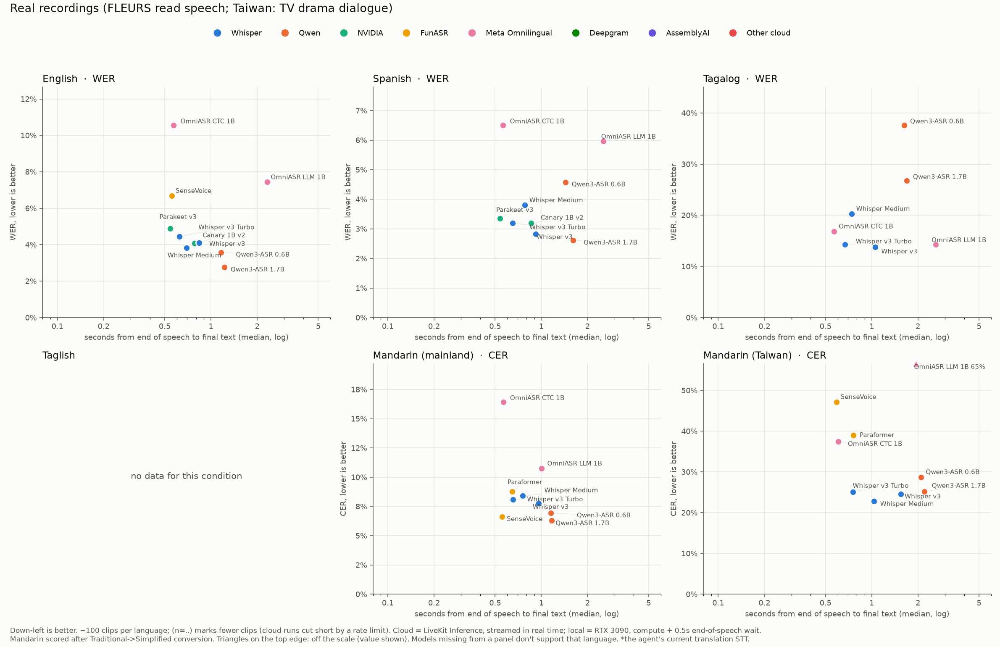
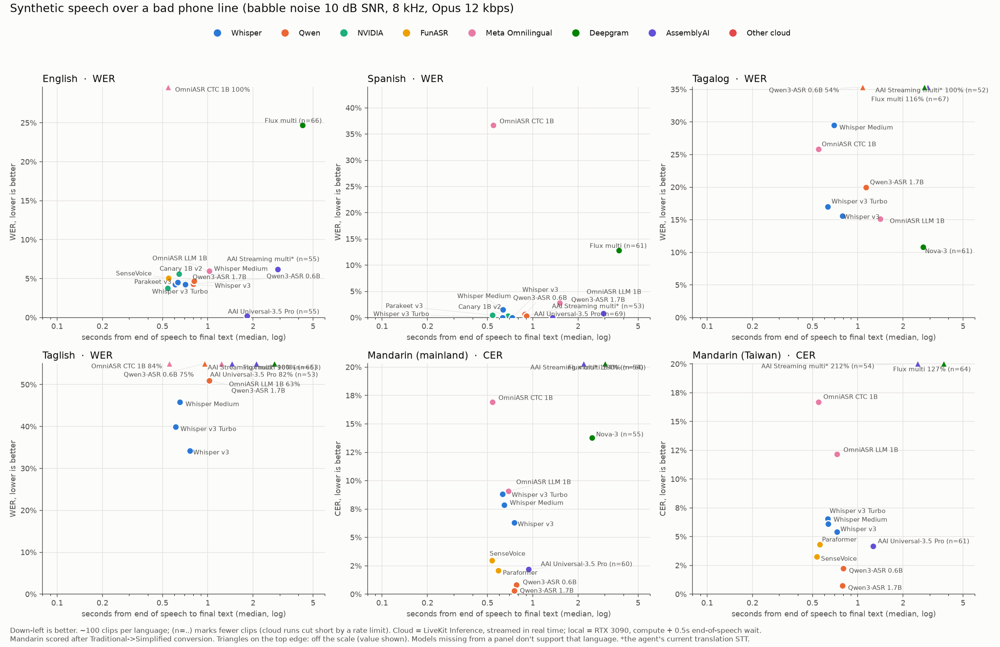
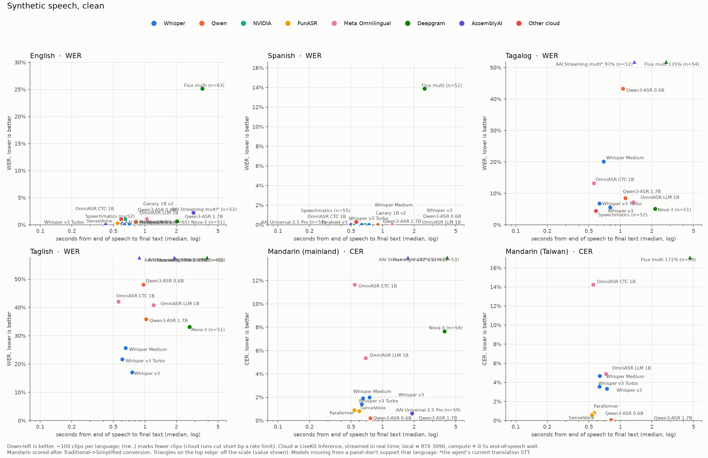
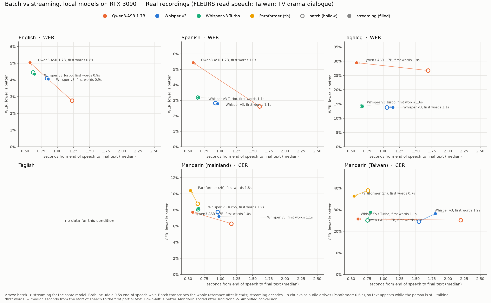
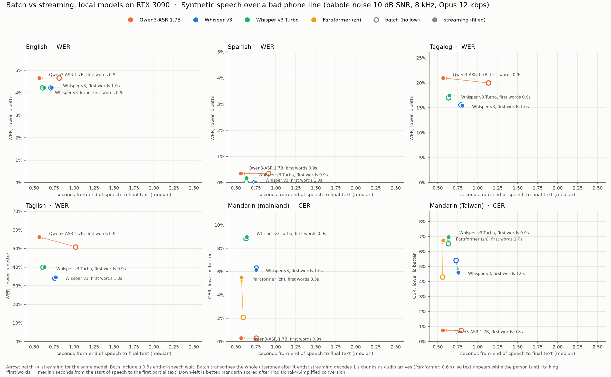
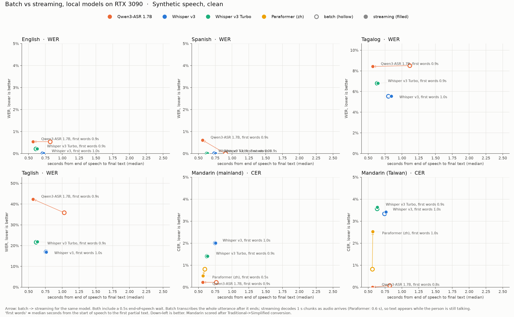
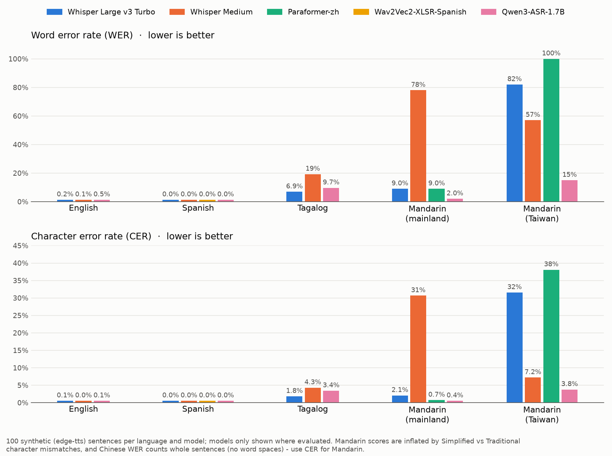

# ASR benchmark — analysis

Which speech-to-text (ASR) model should the support agent use for English,
Spanish, Tagalog, Taglish (Tagalog–English code-switching) and Mandarin
(mainland and Taiwan)? This compares local open models on an RTX 3090 with the
cloud services available through LiveKit Inference, on accuracy and on latency
(seconds from the end of speech to the final text), in batch and streaming mode.

Runs: 27–30 Oct 2026. Scripts and how to re-run them: [README.md](README.md).

## Findings

1. **No single model is best for every language.**
   - **Mandarin:** Qwen3-ASR-1.7B is best by a wide margin (phone line 0.3% CER
     mainland, 0.7% Taiwan; real speech 6.3%), and it is the only model that
     reliably writes Taiwan Mandarin in Traditional characters.
   - **Tagalog / Taglish:** Whisper Large v3 is best among local models (real
     Tagalog 13.8% WER; Taglish 17% clean, 34% phone line). Qwen is weak on
     Tagalog (real 26.7%).
   - **English / Spanish:** almost every model is good. Best on real speech:
     Qwen3-ASR-1.7B (2.8% / 2.6% WER); best on the phone line: AssemblyAI
     Universal-3.5 Pro (cloud, 0.2% / 0.0%).
2. **Taglish defeats everything.** Best is Whisper Large v3 at 17% WER (clean)
   and 34% (phone line); cloud services score 80–100%+. If Filipino callers mix
   languages, this is the largest accuracy risk and needs dedicated work
   (fine-tuning or a code-switching model).
3. **The agent's current translation STT cannot transcribe Mandarin, Tagalog or
   Taglish.** AssemblyAI Universal-Streaming Multilingual scores 100–212% error
   on them (phonetic gibberish such as "woting li xiao xuyo…"). Deepgram Flux
   multilingual is equally bad outside English/Spanish. Both must be replaced
   for those languages.
4. **Local models match or beat the cloud for most languages** and run 11–100×
   faster than real time on one RTX 3090 (compute per clip: Whisper Turbo
   0.13 s, Whisper v3 0.29 s, Qwen3-ASR-1.7B 0.47 s, Parakeet/SenseVoice
   ~0.05 s). Final text arrives 0.5–1.2 s after speech ends, similar to the
   cloud services (0.4–4.6 s median; Deepgram Flux slowest).
5. **Streaming vs batch.**
   - **Qwen3-ASR streaming:** final text always about 0.6 s after speech ends,
     regardless of utterance length (batch: 0.8–2.2 s). On real English/Spanish
     it costs accuracy (2.8→5.0%, 2.6→5.4%); on clean/phone audio, almost none
     (phone-line Mandarin 0.3% in both).
   - **Whisper streaming** (re-decoding the growing buffer): the same accuracy as
     batch, no faster final text; it only adds live partial text, at extra GPU cost.
   - **Paraformer streaming:** slightly faster, somewhat less accurate.
   - **First words:** partial text appears ~0.8–1.2 s after speech starts with
     1 s chunks (Paraformer, 0.6 s chunks: ~0.5 s on synthetic speech).

## Recommendation

Route by language:

| Language | Model | Mode |
|---|---|---|
| Mandarin (mainland, Taiwan) | Qwen3-ASR-1.7B (or SenseVoice if speed matters most) | streaming |
| Tagalog, Taglish | Whisper Large v3 (Turbo for speed) | batch after VAD, or streaming wrapper for live partials |
| English, Spanish | AssemblyAI Universal-3.5 Pro (cloud) or Qwen3-ASR-1.7B / Whisper (local) | streaming |

Local models remove the dependency on LiveKit Inference for STT (which was
rate-limited during this work). Open questions: hosting (production runs on
GCP; the RTX 3090 is on a home network) and whether live partial text is needed
for barge-in.

## Method

**Data (1,700 clips, ~100 per language and condition):**
- **Synthetic, clean:** 100 work-related sentences per language, spoken with
  edge-tts neural voices (`generate_phrases.py`, `synthesize.py`), plus 100
  Taglish support-call sentences alternating a Tagalog and a Philippine-English
  voice (`make_harder.py`).
- **Synthetic, phone line:** every clean clip with babble (four other speakers)
  plus pink noise at 10 dB SNR, 300–3400 Hz narrowband, Opus 12 kbps VoIP
  (`make_harder.py`, `audio_phone/`).
- **Real recordings:** Google FLEURS test split (CC-BY-4.0) for English,
  Spanish, Filipino and mainland Mandarin; Taiwan Mandarin TV-drama dialogue
  (`ryL/Taiwan-mandarin`, licence not stated, internal evaluation only)
  (`make_real.py`). No free real Taglish speech exists. Real audio is not
  committed.

**Models:**
- **Local, RTX 3090** (`bench_gpu.py`, batch size 1, after warm-up): Whisper
  Large v3, v3 Turbo, Medium (faster-whisper fp16); Qwen3-ASR 1.7B and 0.6B;
  Paraformer-zh and SenseVoice-Small (FunASR); NVIDIA Parakeet-TDT-0.6B-v3 and
  Canary-1B-v2 (English/Spanish only); Meta Omnilingual ASR CTC-1B and LLM-1B.
- **Cloud via LiveKit Inference** (`bench_cloud.py`, streamed in real time like
  the agent): Deepgram Nova-3 and Flux multilingual; AssemblyAI
  Universal-Streaming Multilingual and Universal-3.5 Pro; Speechmatics.
- **Streaming mode, local** (`bench_stream.py`): Qwen3-ASR-1.7B (official vLLM
  streaming API, 1 s chunks), Whisper v3 and v3 Turbo (re-decode the growing
  buffer every 1 s), Paraformer-zh-streaming (native, 0.6 s chunks).

**Scoring** (`analyze_v2.py`, `analyze_stream.py`):
- **Mandarin:** both sides converted to Simplified (OpenCC t2s), scored by
  character error rate (CER); WER is meaningless without word spaces.
- **Other languages:** lower-cased, punctuation and hyphens removed, word error
  rate (WER).
- **Latency:** seconds from the end of speech to the final text (median, p90).
  Cloud: measured while streaming, including the provider's endpointing. Local
  batch: GPU compute + a fixed 0.5 s end-of-speech (VAD) wait. Local streaming:
  decode steps placed on a simulated real-time clock, stream closed 0.5 s after
  speech ends. Speech start/end: energy threshold on the clean synthetic clips;
  WebRTC VAD on real recordings.

## Charts

Error vs latency — down-left is better; one panel per language; colour = model
family; triangles on the top edge are off the scale (value in the label).

Batch (hollow) → streaming (filled) for the local models, labelled with time to
first words:

First round (clean synthetic only, Qwen on CPU, before the harder benchmark):

## Caveats

- **Cloud results are partial.** The run tripped LiveKit Inference rate limiting
  (HTTP 429) part-way; cloud rows cover 50–70 clips ("Clips" column), there are
  no cloud results on real recordings, and ElevenLabs Scribe v2 and Cartesia
  Ink-Whisper could not be measured. The 429s also stopped the production agent
  (nightly E2E from 29 Oct).
- **Taiwan real-speech references are subtitles,** which omit words, so every
  model scores ~23–25% CER there; compare models relative to each other only.
- **Synthetic speech flatters every model;** real calls will score worse than
  the clean and phone-line numbers.
- **GPU contention:** other jobs shared the RTX 3090 during some runs; GPU load
  was sampled per clip (`gpu_busy` in the raw results). Timings were re-run on an
  idle GPU where it mattered.
- **Meta Omnilingual CTC-1B** can't be told the language and switches script on
  noisy English (Arabic letters or nothing), hence 100% on the phone-line panel.
- **Qwen3-ASR-0.6B** is genuinely weak on Tagalog (real 37.6% WER).
- **Taglish** exists only as synthetic speech.

## Full results

Generated from `results_v2.csv` (all models) and `results_stream.csv` (batch vs
streaming). Latency includes the 0.5 s end-of-speech wait for local models.

### Synthetic speech, clean

**English** (WER, lower is better)

| Model | WER | Latency p50 | Latency p90 | Where | Clips |
|---|---:|---:|---:|---|---:|
| AAI Universal-3.5 Pro | 0.0% | 0.42 s | 2.15 s | cloud, streaming | 65 |
| Whisper v3 | 0.0% | 0.71 s | 0.99 s | RTX 3090, batch | 100 |
| Whisper Medium | 0.0% | 0.64 s | 0.72 s | RTX 3090, batch | 100 |
| Parakeet v3 | 0.1% | 0.54 s | 0.59 s | RTX 3090, batch | 100 |
| Whisper v3 Turbo | 0.2% | 0.61 s | 0.63 s | RTX 3090, batch | 100 |
| SenseVoice | 0.3% | 0.55 s | 0.59 s | RTX 3090, batch | 100 |
| OmniASR CTC 1B | 0.4% | 0.55 s | 0.58 s | RTX 3090, batch | 100 |
| Qwen3-ASR 1.7B | 0.5% | 0.82 s | 0.94 s | RTX 3090, batch | 100 |
| Nova-3 | 0.6% | 2.03 s | 4.19 s | cloud, streaming | 51 |
| Qwen3-ASR 0.6B | 0.8% | 0.82 s | 0.98 s | RTX 3090, batch | 100 |
| Speechmatics | 1.1% | 0.59 s | 3.24 s | cloud, streaming | 52 |
| Canary 1B v2 | 1.1% | 0.64 s | 0.80 s | RTX 3090, batch | 100 |
| OmniASR LLM 1B | 1.1% | 1.04 s | 1.70 s | RTX 3090, batch | 100 |
| AAI Streaming multi | 2.3% | 2.92 s | 3.89 s | cloud, streaming | 52 |
| Flux multi | 25.1% | 3.54 s | 6.32 s | cloud, streaming | 63 |

**Spanish** (WER, lower is better)

| Model | WER | Latency p50 | Latency p90 | Where | Clips |
|---|---:|---:|---:|---|---:|
| AAI Universal-3.5 Pro | 0.0% | 0.50 s | 1.87 s | cloud, streaming | 51 |
| Canary 1B v2 | 0.0% | 0.69 s | 0.85 s | RTX 3090, batch | 100 |
| OmniASR CTC 1B | 0.0% | 0.55 s | 0.58 s | RTX 3090, batch | 100 |
| OmniASR LLM 1B | 0.0% | 1.23 s | 1.96 s | RTX 3090, batch | 100 |
| Parakeet v3 | 0.0% | 0.54 s | 0.58 s | RTX 3090, batch | 100 |
| Qwen3-ASR 0.6B | 0.0% | 0.90 s | 1.15 s | RTX 3090, batch | 100 |
| Qwen3-ASR 1.7B | 0.0% | 0.90 s | 1.10 s | RTX 3090, batch | 100 |
| Whisper v3 | 0.0% | 0.74 s | 0.99 s | RTX 3090, batch | 100 |
| Whisper v3 Turbo | 0.0% | 0.63 s | 0.83 s | RTX 3090, batch | 100 |
| Whisper Medium | 0.0% | 0.63 s | 0.65 s | RTX 3090, batch | 100 |
| Speechmatics | 0.3% | 0.56 s | 2.68 s | cloud, streaming | 55 |
| Flux multi | 13.9% | 2.52 s | 5.18 s | cloud, streaming | 51 |

**Tagalog** (WER, lower is better)

| Model | WER | Latency p50 | Latency p90 | Where | Clips |
|---|---:|---:|---:|---|---:|
| Speechmatics | 4.5% | 0.58 s | 2.14 s | cloud, streaming | 52 |
| Nova-3 | 5.1% | 2.15 s | 4.19 s | cloud, streaming | 51 |
| Whisper v3 | 5.6% | 0.80 s | 1.11 s | RTX 3090, batch | 100 |
| Whisper v3 Turbo | 6.8% | 0.63 s | 0.67 s | RTX 3090, batch | 100 |
| OmniASR LLM 1B | 7.2% | 1.33 s | 1.92 s | RTX 3090, batch | 100 |
| Qwen3-ASR 1.7B | 8.5% | 1.12 s | 1.30 s | RTX 3090, batch | 100 |
| OmniASR CTC 1B | 13.3% | 0.56 s | 0.59 s | RTX 3090, batch | 100 |
| Whisper Medium | 20.2% | 0.69 s | 0.76 s | RTX 3090, batch | 100 |
| Qwen3-ASR 0.6B | 43.3% | 1.06 s | 1.38 s | RTX 3090, batch | 100 |
| AAI Streaming multi | 96.9% | 1.36 s | 3.28 s | cloud, streaming | 52 |
| Flux multi | 134.6% | 2.73 s | 4.73 s | cloud, streaming | 54 |

**Taglish** (WER, lower is better)

| Model | WER | Latency p50 | Latency p90 | Where | Clips |
|---|---:|---:|---:|---|---:|
| Whisper v3 | 17.0% | 0.76 s | 1.06 s | RTX 3090, batch | 100 |
| Whisper v3 Turbo | 21.6% | 0.61 s | 0.61 s | RTX 3090, batch | 100 |
| Whisper Medium | 25.7% | 0.66 s | 0.70 s | RTX 3090, batch | 100 |
| Nova-3 | 33.1% | 2.67 s | 4.13 s | cloud, streaming | 51 |
| Qwen3-ASR 1.7B | 35.9% | 1.03 s | 1.22 s | RTX 3090, batch | 100 |
| OmniASR LLM 1B | 40.8% | 1.21 s | 1.75 s | RTX 3090, batch | 100 |
| OmniASR CTC 1B | 42.0% | 0.56 s | 0.58 s | RTX 3090, batch | 100 |
| Qwen3-ASR 0.6B | 48.1% | 0.96 s | 1.28 s | RTX 3090, batch | 100 |
| AAI Streaming multi | 82.8% | 1.91 s | 3.68 s | cloud, streaming | 58 |
| Flux multi | 95.2% | 3.94 s | 4.63 s | cloud, streaming | 68 |
| AAI Universal-3.5 Pro | 132.0% | 0.88 s | 2.25 s | cloud, streaming | 62 |

**Mandarin (mainland)** (CER, lower is better)

| Model | CER | Latency p50 | Latency p90 | Where | Clips |
|---|---:|---:|---:|---|---:|
| Qwen3-ASR 0.6B | 0.0% | 0.76 s | 0.94 s | RTX 3090, batch | 100 |
| Qwen3-ASR 1.7B | 0.2% | 0.77 s | 0.91 s | RTX 3090, batch | 100 |
| AAI Universal-3.5 Pro | 0.6% | 1.91 s | 2.59 s | cloud, streaming | 59 |
| Paraformer | 0.8% | 0.59 s | 0.65 s | RTX 3090, batch | 100 |
| SenseVoice | 0.9% | 0.54 s | 0.59 s | RTX 3090, batch | 100 |
| Whisper v3 Turbo | 1.4% | 0.63 s | 0.68 s | RTX 3090, batch | 100 |
| Whisper Medium | 1.9% | 0.65 s | 0.71 s | RTX 3090, batch | 100 |
| Whisper v3 | 2.0% | 0.75 s | 1.09 s | RTX 3090, batch | 100 |
| OmniASR LLM 1B | 5.3% | 0.69 s | 1.11 s | RTX 3090, batch | 100 |
| Nova-3 | 7.7% | 3.90 s | 4.39 s | cloud, streaming | 54 |
| OmniASR CTC 1B | 11.7% | 0.54 s | 0.55 s | RTX 3090, batch | 100 |
| Flux multi | 182.4% | 4.14 s | 5.28 s | cloud, streaming | 65 |
| AAI Streaming multi | 251.1% | 1.75 s | 4.16 s | cloud, streaming | 53 |

**Mandarin (Taiwan)** (CER, lower is better)

| Model | CER | Latency p50 | Latency p90 | Where | Clips |
|---|---:|---:|---:|---|---:|
| Qwen3-ASR 0.6B | 0.1% | 0.81 s | 0.96 s | RTX 3090, batch | 100 |
| Qwen3-ASR 1.7B | 0.1% | 0.82 s | 0.91 s | RTX 3090, batch | 100 |
| SenseVoice | 0.6% | 0.54 s | 0.58 s | RTX 3090, batch | 100 |
| Paraformer | 0.8% | 0.56 s | 0.64 s | RTX 3090, batch | 100 |
| Whisper v3 | 3.3% | 0.74 s | 0.90 s | RTX 3090, batch | 100 |
| Whisper v3 Turbo | 3.6% | 0.63 s | 0.72 s | RTX 3090, batch | 100 |
| Whisper Medium | 4.7% | 0.63 s | 0.70 s | RTX 3090, batch | 100 |
| OmniASR LLM 1B | 4.9% | 0.73 s | 0.90 s | RTX 3090, batch | 100 |
| OmniASR CTC 1B | 14.2% | 0.55 s | 0.58 s | RTX 3090, batch | 100 |
| Flux multi | 171.2% | 4.63 s | 6.30 s | cloud, streaming | 59 |

### Synthetic speech over a bad phone line (babble noise 10 dB SNR, 8 kHz, Opus 12 kbps)

**English** (WER, lower is better)

| Model | WER | Latency p50 | Latency p90 | Where | Clips |
|---|---:|---:|---:|---|---:|
| AAI Universal-3.5 Pro | 0.2% | 1.82 s | 2.26 s | cloud, streaming | 55 |
| Parakeet v3 | 3.8% | 0.54 s | 0.59 s | RTX 3090, batch | 100 |
| Whisper v3 | 4.2% | 0.71 s | 0.98 s | RTX 3090, batch | 100 |
| Whisper v3 Turbo | 4.2% | 0.61 s | 0.63 s | RTX 3090, batch | 100 |
| Qwen3-ASR 0.6B | 4.3% | 0.80 s | 0.99 s | RTX 3090, batch | 100 |
| Whisper Medium | 4.5% | 0.63 s | 0.68 s | RTX 3090, batch | 100 |
| Qwen3-ASR 1.7B | 4.7% | 0.81 s | 0.93 s | RTX 3090, batch | 100 |
| SenseVoice | 5.1% | 0.55 s | 0.59 s | RTX 3090, batch | 100 |
| Canary 1B v2 | 5.6% | 0.64 s | 0.78 s | RTX 3090, batch | 100 |
| OmniASR LLM 1B | 6.0% | 1.02 s | 1.57 s | RTX 3090, batch | 100 |
| AAI Streaming multi | 6.2% | 2.91 s | 4.44 s | cloud, streaming | 55 |
| Flux multi | 24.7% | 4.26 s | 5.34 s | cloud, streaming | 66 |
| OmniASR CTC 1B | 100.0% | 0.54 s | 0.57 s | RTX 3090, batch | 100 |

**Spanish** (WER, lower is better)

| Model | WER | Latency p50 | Latency p90 | Where | Clips |
|---|---:|---:|---:|---|---:|
| AAI Universal-3.5 Pro | 0.0% | 1.35 s | 1.93 s | cloud, streaming | 69 |
| Whisper v3 | 0.0% | 0.73 s | 0.99 s | RTX 3090, batch | 100 |
| Whisper v3 Turbo | 0.0% | 0.63 s | 0.77 s | RTX 3090, batch | 100 |
| Canary 1B v2 | 0.4% | 0.69 s | 0.84 s | RTX 3090, batch | 100 |
| Qwen3-ASR 1.7B | 0.4% | 0.91 s | 1.14 s | RTX 3090, batch | 100 |
| Parakeet v3 | 0.4% | 0.54 s | 0.58 s | RTX 3090, batch | 100 |
| Qwen3-ASR 0.6B | 0.6% | 0.89 s | 1.21 s | RTX 3090, batch | 100 |
| AAI Streaming multi | 0.8% | 2.95 s | 4.33 s | cloud, streaming | 53 |
| Whisper Medium | 1.5% | 0.63 s | 0.65 s | RTX 3090, batch | 100 |
| OmniASR LLM 1B | 2.8% | 1.50 s | 1.94 s | RTX 3090, batch | 100 |
| Flux multi | 12.8% | 3.74 s | 4.81 s | cloud, streaming | 61 |
| OmniASR CTC 1B | 36.7% | 0.55 s | 0.58 s | RTX 3090, batch | 100 |

**Tagalog** (WER, lower is better)

| Model | WER | Latency p50 | Latency p90 | Where | Clips |
|---|---:|---:|---:|---|---:|
| Nova-3 | 10.8% | 2.72 s | 4.66 s | cloud, streaming | 61 |
| OmniASR LLM 1B | 15.1% | 1.41 s | 1.94 s | RTX 3090, batch | 100 |
| Whisper v3 | 15.6% | 0.79 s | 1.07 s | RTX 3090, batch | 100 |
| Whisper v3 Turbo | 17.0% | 0.63 s | 0.70 s | RTX 3090, batch | 100 |
| Qwen3-ASR 1.7B | 20.0% | 1.13 s | 1.28 s | RTX 3090, batch | 100 |
| OmniASR CTC 1B | 25.8% | 0.55 s | 0.59 s | RTX 3090, batch | 100 |
| Whisper Medium | 29.5% | 0.69 s | 0.94 s | RTX 3090, batch | 100 |
| Qwen3-ASR 0.6B | 54.1% | 1.08 s | 1.38 s | RTX 3090, batch | 100 |
| AAI Streaming multi | 100.4% | 2.92 s | 3.73 s | cloud, streaming | 52 |
| Flux multi | 115.5% | 2.76 s | 4.91 s | cloud, streaming | 67 |

**Taglish** (WER, lower is better)

| Model | WER | Latency p50 | Latency p90 | Where | Clips |
|---|---:|---:|---:|---|---:|
| Whisper v3 | 34.2% | 0.76 s | 1.11 s | RTX 3090, batch | 100 |
| Whisper v3 Turbo | 39.9% | 0.61 s | 0.62 s | RTX 3090, batch | 100 |
| Whisper Medium | 45.9% | 0.65 s | 0.77 s | RTX 3090, batch | 100 |
| Qwen3-ASR 1.7B | 50.9% | 1.02 s | 1.19 s | RTX 3090, batch | 100 |
| OmniASR LLM 1B | 63.0% | 1.23 s | 1.79 s | RTX 3090, batch | 100 |
| Qwen3-ASR 0.6B | 74.8% | 0.95 s | 1.27 s | RTX 3090, batch | 100 |
| AAI Universal-3.5 Pro | 82.3% | 1.45 s | 2.42 s | cloud, streaming | 53 |
| OmniASR CTC 1B | 84.0% | 0.56 s | 0.58 s | RTX 3090, batch | 100 |
| AAI Streaming multi | 96.0% | 2.11 s | 4.18 s | cloud, streaming | 65 |
| Flux multi | 99.6% | 2.76 s | 4.83 s | cloud, streaming | 63 |

**Mandarin (mainland)** (CER, lower is better)

| Model | CER | Latency p50 | Latency p90 | Where | Clips |
|---|---:|---:|---:|---|---:|
| Qwen3-ASR 1.7B | 0.3% | 0.76 s | 0.92 s | RTX 3090, batch | 100 |
| Qwen3-ASR 0.6B | 0.8% | 0.78 s | 0.94 s | RTX 3090, batch | 100 |
| Paraformer | 2.1% | 0.59 s | 0.64 s | RTX 3090, batch | 100 |
| AAI Universal-3.5 Pro | 2.2% | 0.94 s | 2.06 s | cloud, streaming | 60 |
| SenseVoice | 3.0% | 0.54 s | 0.59 s | RTX 3090, batch | 100 |
| Whisper v3 | 6.3% | 0.75 s | 1.07 s | RTX 3090, batch | 100 |
| Whisper Medium | 7.9% | 0.65 s | 0.70 s | RTX 3090, batch | 100 |
| Whisper v3 Turbo | 8.8% | 0.63 s | 0.69 s | RTX 3090, batch | 100 |
| OmniASR LLM 1B | 9.1% | 0.69 s | 1.15 s | RTX 3090, batch | 100 |
| Nova-3 | 13.8% | 2.48 s | 4.41 s | cloud, streaming | 55 |
| OmniASR CTC 1B | 16.9% | 0.54 s | 0.56 s | RTX 3090, batch | 100 |
| Flux multi | 130.0% | 3.02 s | 4.92 s | cloud, streaming | 60 |
| AAI Streaming multi | 193.6% | 2.18 s | 4.07 s | cloud, streaming | 54 |

**Mandarin (Taiwan)** (CER, lower is better)

| Model | CER | Latency p50 | Latency p90 | Where | Clips |
|---|---:|---:|---:|---|---:|
| Qwen3-ASR 1.7B | 0.7% | 0.79 s | 0.91 s | RTX 3090, batch | 100 |
| Qwen3-ASR 0.6B | 2.2% | 0.80 s | 0.96 s | RTX 3090, batch | 100 |
| SenseVoice | 3.3% | 0.54 s | 0.58 s | RTX 3090, batch | 100 |
| AAI Universal-3.5 Pro | 4.2% | 1.26 s | 2.18 s | cloud, streaming | 61 |
| Paraformer | 4.3% | 0.56 s | 0.64 s | RTX 3090, batch | 100 |
| Whisper v3 | 5.4% | 0.73 s | 0.84 s | RTX 3090, batch | 100 |
| Whisper Medium | 6.1% | 0.64 s | 0.69 s | RTX 3090, batch | 100 |
| Whisper v3 Turbo | 6.5% | 0.63 s | 0.67 s | RTX 3090, batch | 100 |
| OmniASR LLM 1B | 12.2% | 0.73 s | 0.96 s | RTX 3090, batch | 100 |
| OmniASR CTC 1B | 16.7% | 0.55 s | 0.58 s | RTX 3090, batch | 100 |
| Flux multi | 126.7% | 3.72 s | 5.06 s | cloud, streaming | 64 |
| AAI Streaming multi | 212.3% | 2.50 s | 4.33 s | cloud, streaming | 54 |

### Real recordings (FLEURS read speech; Taiwan: TV drama dialogue)

**English** (WER, lower is better)

| Model | WER | Latency p50 | Latency p90 | Where | Clips |
|---|---:|---:|---:|---|---:|
| Qwen3-ASR 1.7B | 2.8% | 1.23 s | 1.56 s | RTX 3090, batch | 100 |
| Qwen3-ASR 0.6B | 3.6% | 1.16 s | 1.69 s | RTX 3090, batch | 100 |
| Whisper Medium | 3.8% | 0.69 s | 0.76 s | RTX 3090, batch | 100 |
| Canary 1B v2 | 4.1% | 0.78 s | 1.06 s | RTX 3090, batch | 100 |
| Whisper v3 | 4.1% | 0.84 s | 1.25 s | RTX 3090, batch | 100 |
| Whisper v3 Turbo | 4.5% | 0.62 s | 0.64 s | RTX 3090, batch | 100 |
| Parakeet v3 | 4.9% | 0.54 s | 0.56 s | RTX 3090, batch | 100 |
| SenseVoice | 6.7% | 0.56 s | 0.59 s | RTX 3090, batch | 100 |
| OmniASR LLM 1B | 7.4% | 2.33 s | 3.37 s | RTX 3090, batch | 100 |
| OmniASR CTC 1B | 10.5% | 0.57 s | 0.60 s | RTX 3090, batch | 100 |

**Spanish** (WER, lower is better)

| Model | WER | Latency p50 | Latency p90 | Where | Clips |
|---|---:|---:|---:|---|---:|
| Qwen3-ASR 1.7B | 2.6% | 1.61 s | 2.01 s | RTX 3090, batch | 100 |
| Whisper v3 | 2.8% | 0.92 s | 1.40 s | RTX 3090, batch | 100 |
| Canary 1B v2 | 3.2% | 0.86 s | 1.17 s | RTX 3090, batch | 100 |
| Whisper v3 Turbo | 3.2% | 0.65 s | 0.69 s | RTX 3090, batch | 100 |
| Parakeet v3 | 3.4% | 0.54 s | 0.54 s | RTX 3090, batch | 100 |
| Whisper Medium | 3.8% | 0.78 s | 0.99 s | RTX 3090, batch | 100 |
| Qwen3-ASR 0.6B | 4.6% | 1.44 s | 2.12 s | RTX 3090, batch | 100 |
| OmniASR LLM 1B | 6.0% | 2.54 s | 3.89 s | RTX 3090, batch | 100 |
| OmniASR CTC 1B | 6.5% | 0.56 s | 0.60 s | RTX 3090, batch | 100 |

**Tagalog** (WER, lower is better)

| Model | WER | Latency p50 | Latency p90 | Where | Clips |
|---|---:|---:|---:|---|---:|
| Whisper v3 | 13.8% | 1.05 s | 1.58 s | RTX 3090, batch | 100 |
| OmniASR LLM 1B | 14.2% | 2.62 s | 3.83 s | RTX 3090, batch | 100 |
| Whisper v3 Turbo | 14.2% | 0.67 s | 0.76 s | RTX 3090, batch | 100 |
| OmniASR CTC 1B | 16.8% | 0.57 s | 0.60 s | RTX 3090, batch | 100 |
| Whisper Medium | 20.3% | 0.74 s | 0.81 s | RTX 3090, batch | 100 |
| Qwen3-ASR 1.7B | 26.7% | 1.69 s | 2.30 s | RTX 3090, batch | 100 |
| Qwen3-ASR 0.6B | 37.6% | 1.62 s | 2.38 s | RTX 3090, batch | 100 |

**Mandarin (mainland)** (CER, lower is better)

| Model | CER | Latency p50 | Latency p90 | Where | Clips |
|---|---:|---:|---:|---|---:|
| Qwen3-ASR 1.7B | 6.3% | 1.17 s | 1.57 s | RTX 3090, batch | 100 |
| SenseVoice | 6.6% | 0.56 s | 0.57 s | RTX 3090, batch | 100 |
| Qwen3-ASR 0.6B | 6.9% | 1.15 s | 1.56 s | RTX 3090, batch | 100 |
| Whisper v3 | 7.8% | 0.96 s | 1.46 s | RTX 3090, batch | 100 |
| Whisper v3 Turbo | 8.1% | 0.66 s | 0.69 s | RTX 3090, batch | 100 |
| Whisper Medium | 8.4% | 0.76 s | 0.92 s | RTX 3090, batch | 100 |
| Paraformer | 8.8% | 0.65 s | 0.76 s | RTX 3090, batch | 100 |
| OmniASR LLM 1B | 10.7% | 1.00 s | 1.87 s | RTX 3090, batch | 100 |
| OmniASR CTC 1B | 16.4% | 0.56 s | 0.60 s | RTX 3090, batch | 100 |

**Mandarin (Taiwan)** (CER, lower is better)

| Model | CER | Latency p50 | Latency p90 | Where | Clips |
|---|---:|---:|---:|---|---:|
| Whisper Medium | 22.8% | 1.03 s | 1.38 s | RTX 3090, batch | 100 |
| Whisper v3 | 24.5% | 1.55 s | 2.36 s | RTX 3090, batch | 100 |
| Whisper v3 Turbo | 25.1% | 0.76 s | 1.05 s | RTX 3090, batch | 100 |
| Qwen3-ASR 1.7B | 25.2% | 2.20 s | 3.08 s | RTX 3090, batch | 100 |
| Qwen3-ASR 0.6B | 28.7% | 2.10 s | 2.88 s | RTX 3090, batch | 100 |
| OmniASR CTC 1B | 37.4% | 0.60 s | 0.66 s | RTX 3090, batch | 100 |
| Paraformer | 39.0% | 0.76 s | 0.90 s | RTX 3090, batch | 100 |
| SenseVoice | 47.2% | 0.59 s | 0.61 s | RTX 3090, batch | 100 |
| OmniASR LLM 1B | 65.3% | 1.94 s | 3.60 s | RTX 3090, batch | 100 |

### Batch vs streaming (local models)

**Synthetic speech, clean**

| Language | Model | Batch error | Streaming error | Batch final latency | Streaming final latency | Streaming first words |
|---|---|---:|---:|---:|---:|---:|
| English | Qwen3-ASR 1.7B | 0.5% | 0.5% | 0.82 s | 0.57 s | 0.86 s |
| English | Whisper v3 | 0.0% | 0.0% | 0.71 s | 0.72 s | 0.97 s |
| English | Whisper v3 Turbo | 0.2% | 0.2% | 0.61 s | 0.63 s | 0.92 s |
| Spanish | Qwen3-ASR 1.7B | 0.0% | 0.6% | 0.90 s | 0.56 s | 0.87 s |
| Spanish | Whisper v3 | 0.0% | 0.0% | 0.74 s | 0.76 s | 1.00 s |
| Spanish | Whisper v3 Turbo | 0.0% | 0.0% | 0.63 s | 0.63 s | 0.93 s |
| Tagalog | Qwen3-ASR 1.7B | 8.5% | 8.4% | 1.12 s | 0.57 s | 0.88 s |
| Tagalog | Whisper v3 | 5.6% | 5.6% | 0.80 s | 0.84 s | 1.00 s |
| Tagalog | Whisper v3 Turbo | 6.8% | 6.8% | 0.63 s | 0.65 s | 0.93 s |
| Taglish | Qwen3-ASR 1.7B | 35.9% | 42.4% | 1.03 s | 0.57 s | 0.88 s |
| Taglish | Whisper v3 | 17.0% | 16.9% | 0.76 s | 0.76 s | 0.98 s |
| Taglish | Whisper v3 Turbo | 21.6% | 21.9% | 0.61 s | 0.63 s | 0.91 s |
| Mandarin (mainland) | Qwen3-ASR 1.7B | 0.2% | 0.2% | 0.76 s | 0.57 s | 0.86 s |
| Mandarin (mainland) | Whisper v3 | 2.0% | 2.0% | 0.75 s | 0.76 s | 0.97 s |
| Mandarin (mainland) | Whisper v3 Turbo | 1.4% | 1.4% | 0.63 s | 0.64 s | 0.92 s |
| Mandarin (mainland) | Paraformer (zh) | 0.8% | 0.5% | 0.60 s | 0.57 s | 0.48 s |
| Mandarin (Taiwan) | Qwen3-ASR 1.7B | 0.1% | 0.0% | 0.82 s | 0.56 s | 0.85 s |
| Mandarin (Taiwan) | Whisper v3 | 3.3% | 3.4% | 0.74 s | 0.76 s | 0.97 s |
| Mandarin (Taiwan) | Whisper v3 Turbo | 3.6% | 3.6% | 0.63 s | 0.64 s | 0.91 s |
| Mandarin (Taiwan) | Paraformer (zh) | 0.8% | 2.5% | 0.56 s | 0.57 s | 1.04 s |

**Synthetic speech over a bad phone line (babble noise 10 dB SNR, 8 kHz, Opus 12 kbps)**

| Language | Model | Batch error | Streaming error | Batch final latency | Streaming final latency | Streaming first words |
|---|---|---:|---:|---:|---:|---:|
| English | Qwen3-ASR 1.7B | 4.7% | 4.7% | 0.81 s | 0.57 s | 0.86 s |
| English | Whisper v3 | 4.2% | 4.2% | 0.71 s | 0.72 s | 0.97 s |
| English | Whisper v3 Turbo | 4.2% | 4.2% | 0.61 s | 0.63 s | 0.92 s |
| Spanish | Qwen3-ASR 1.7B | 0.3% | 0.3% | 0.91 s | 0.56 s | 0.87 s |
| Spanish | Whisper v3 | 0.0% | 0.0% | 0.73 s | 0.75 s | 0.99 s |
| Spanish | Whisper v3 Turbo | 0.0% | 0.2% | 0.63 s | 0.63 s | 0.93 s |
| Tagalog | Qwen3-ASR 1.7B | 20.0% | 21.0% | 1.13 s | 0.57 s | 0.88 s |
| Tagalog | Whisper v3 | 15.6% | 15.4% | 0.79 s | 0.81 s | 1.00 s |
| Tagalog | Whisper v3 Turbo | 17.0% | 17.5% | 0.63 s | 0.65 s | 0.93 s |
| Taglish | Qwen3-ASR 1.7B | 50.9% | 56.3% | 1.02 s | 0.57 s | 0.88 s |
| Taglish | Whisper v3 | 34.2% | 34.5% | 0.76 s | 0.77 s | 0.98 s |
| Taglish | Whisper v3 Turbo | 39.9% | 40.0% | 0.61 s | 0.63 s | 0.91 s |
| Mandarin (mainland) | Qwen3-ASR 1.7B | 0.3% | 0.3% | 0.76 s | 0.57 s | 0.86 s |
| Mandarin (mainland) | Whisper v3 | 6.3% | 6.2% | 0.75 s | 0.76 s | 0.97 s |
| Mandarin (mainland) | Whisper v3 Turbo | 8.8% | 9.0% | 0.63 s | 0.63 s | 0.92 s |
| Mandarin (mainland) | Paraformer (zh) | 2.1% | 5.5% | 0.59 s | 0.57 s | 0.47 s |
| Mandarin (Taiwan) | Qwen3-ASR 1.7B | 0.7% | 0.7% | 0.79 s | 0.56 s | 0.85 s |
| Mandarin (Taiwan) | Whisper v3 | 5.4% | 4.6% | 0.73 s | 0.76 s | 0.96 s |
| Mandarin (Taiwan) | Whisper v3 Turbo | 6.5% | 7.0% | 0.63 s | 0.63 s | 0.91 s |
| Mandarin (Taiwan) | Paraformer (zh) | 4.3% | 6.8% | 0.56 s | 0.57 s | 1.03 s |

**Real recordings (FLEURS read speech; Taiwan: TV drama dialogue)**

| Language | Model | Batch error | Streaming error | Batch final latency | Streaming final latency | Streaming first words |
|---|---|---:|---:|---:|---:|---:|
| English | Qwen3-ASR 1.7B | 2.8% | 5.0% | 1.23 s | 0.58 s | 0.78 s |
| English | Whisper v3 | 4.1% | 4.1% | 0.84 s | 0.86 s | 0.94 s |
| English | Whisper v3 Turbo | 4.5% | 4.4% | 0.62 s | 0.65 s | 0.87 s |
| Spanish | Qwen3-ASR 1.7B | 2.6% | 5.4% | 1.61 s | 0.58 s | 1.01 s |
| Spanish | Whisper v3 | 2.8% | 2.8% | 0.92 s | 0.96 s | 1.12 s |
| Spanish | Whisper v3 Turbo | 3.2% | 3.2% | 0.65 s | 0.67 s | 1.07 s |
| Tagalog | Qwen3-ASR 1.7B | 26.7% | 29.5% | 1.69 s | 0.59 s | 1.83 s |
| Tagalog | Whisper v3 | 13.8% | 13.9% | 1.05 s | 1.15 s | 1.14 s |
| Tagalog | Whisper v3 Turbo | 14.2% | 14.2% | 0.67 s | 0.68 s | 1.65 s |
| Mandarin (mainland) | Qwen3-ASR 1.7B | 6.3% | 7.7% | 1.17 s | 0.57 s | 1.00 s |
| Mandarin (mainland) | Whisper v3 | 7.8% | 7.2% | 0.96 s | 0.98 s | 1.14 s |
| Mandarin (mainland) | Whisper v3 Turbo | 8.1% | 8.2% | 0.66 s | 0.66 s | 1.18 s |
| Mandarin (mainland) | Paraformer (zh) | 8.8% | 10.4% | 0.65 s | 0.54 s | 1.83 s |
| Mandarin (Taiwan) | Qwen3-ASR 1.7B | 25.2% | 25.8% | 2.20 s | 0.61 s | 1.05 s |
| Mandarin (Taiwan) | Whisper v3 | 24.5% | 28.3% | 1.55 s | 1.80 s | 1.16 s |
| Mandarin (Taiwan) | Whisper v3 Turbo | 25.1% | 29.0% | 0.76 s | 0.80 s | 1.11 s |
| Mandarin (Taiwan) | Paraformer (zh) | 39.0% | 36.4% | 0.76 s | 0.55 s | 0.66 s |

